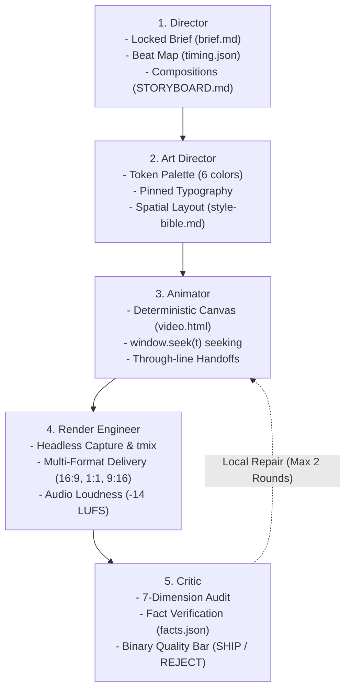

# Motion Studio: Autonomous Motion Engineering Framework
*The Standard for Code-Rendered Product Films & Spatial UI Choreography*

This skill documents the end-to-end production architecture for engineering code-rendered product launch films, brand explainer videos, and interactive software showcases. Based on Mori's Motion Engineering principles, this framework replaces subjective animation with deterministic, testable code and strict inter-department contracts.

> **Production Standard:**  
> *"A film is not complete because the MP4 exists; it is complete when the approved brief and verification requirements are met."*

---

## 1. Studio Architecture: The 5 Departments

The studio enforces strict separation of concerns across 5 specialized roles:



### Department Responsibilities & Output Contracts

1. **Director**
   - **Input:** Client website, business proposal, pitch decks, product code, audio score.
   - **Outputs:**
     - `brief.md`: Mode, subject, target viewer, desired end state, length, fps, verified facts list, 3 signature moments.
     - `timing.json`: Frame-accurate beat grid (BPM, beat interval, composition start/end frames, transient SFX markers).
     - `STORYBOARD.md`: Compositions C01–CN with timecodes, frame boundaries, on-screen text, purpose, and visual handoff coordinates.

2. **Art Director**
   - **Input:** `brief.md`, brand guidelines, live CSS.
   - **Outputs:**
     - `style-bible.md`: Authoritative token contract:
       - Exactly 6 approved HEX colors (`ink`, `surface`, `line`, `cloud`, `steel`, `signal`).
       - Pinned typography stack (font-family, weights, tracking, line-heights).
       - Spatial grid rules, corner radii, shadow elevations, and 3D isometric camera angles.

3. **Animator**
   - **Input:** `style-bible.md`, `timing.json`, `STORYBOARD.md`.
   - **Outputs:**
     - `video.html` (or Remotion root): Programmatic animation canvas exposing deterministic frame seeking (`window.seek(targetFrame)`).
     - Pure mathematical easings (Bézier, smoothstep, damped harmonic oscillators).
     - Spatial through-line persistence (`THE CARRIER BAR`) across all composition transitions.

4. **Render Engineer**
   - **Input:** `video.html`, `timing.json`, raw audio tracks.
   - **Outputs:**
     - Multi-format delivery package (`outputs/delivery/`):
       - `master_16x9.mp4`: 1920×1080 @ 60fps, full audio mix (-14.0 LUFS target).
       - `music_only_16x9.mp4`: 1920×1080 @ 60fps, clean music stem.
       - `square_1x1.mp4`: 1080×1080 @ 60fps, responsive blurred padding fill.
       - `vertical_9x16.mp4`: 1080×1920 @ 60fps, mobile safe-zone optimized.
       - Posters (`poster_16x9.png`, `poster_1x1.png`, `poster_9x16.png`).
       - `contact_sheet_16_frames.jpg`: 4×4 diagnostic contact sheet.
       - `manifest.json`: Full technical metadata, audio loudness stats, and SHA-256 hashes.

5. **Critic**
   - **Input:** Rendered delivery package, `facts.json`, `timing.json`, `style-bible.md`.
   - **Outputs:**
     - `reviews/findings.md`: Rigorous multi-pass audit report:
       - 7-dimension quantitative scorecard (Visual composition, Typography, Product readability, Motion quality, Timing, Continuity, Brand consistency).
       - Sound-off narrative breakdown.
       - Sub-frame audio-visual synchronization audit.
       - Zero-invention fact verification against `facts.json`.
       - Final binary verdict: **"SHIP"** or **"REJECT WITH LOCAL REPAIR PLAN"**.

---

## 2. The 10 Operating Rules

1. **Frame One Finished Picture (`t = 0.0s`)**: Never start on black frames, blank canvases, or opacity fades. Frame 0 must be an eye-stopping, finished editorial still. Hook occurs in `< 1.0s`.
2. **Through-Line Carrier Bar**: A continuous physical/geometric anchor guides eye-trace across every scene and transforms logically into the final logo.
3. **Deterministic Timeline (`f = 0..N-1`)**: All animations evaluate as pure functions of integer frame numbers. No `requestAnimationFrame` or wall-clock timers.
4. **Zero Invented UI or Claims**: Every metric, headline, price tier, and testimonial must be sourced verbatim from `facts.json`.
5. **Audio-First Downbeats**: Cuts, hits, and layout shifts snap within ±1 frame of the audio beat map in `timing.json`.
6. **Sound-Off Narrative Autonomy**: The visual narrative must be 100% understandable with the volume muted.
7. **Strict Typographic & Contrast Discipline**: WCAG AAA (`≥ 7.0:1`) for headlines, AA (`≥ 4.5:1`) for body. Pinned fonts, no collisions, strict margins (`≥ 120px` horiz, `≥ 80px` vert).
8. **3D Spatial Integrity**: Showcases use true perspective matrices (e.g., 42° pitch) with discrete physical layer strata (`Z=0`, `Z=+36px`, `Z=+72px`) and directional lighting.
9. **Local Repair Policy (Max 2 Rounds)**: Critic rejections trigger targeted surgical edits on specific frames/components. No indiscriminate whole-project rewrites.
10. **Unattended Stop Condition**: Production halts only when the Critic confirms **"SHIP"** on all criteria.

---

## 3. Standard Delivery Specifications

| Asset | Spec | Audio Spec | Visual Layout |
| :--- | :--- | :--- | :--- |
| **`master_16x9.mp4`** | 1920×1080 @ 60fps | Integrated -14.0 LUFS (±0.5), TP ≤ -1.0 dBTP | Full widescreen canvas |
| **`music_only.mp4`** | 1920×1080 @ 60fps | Integrated -14.0 LUFS (±0.5), TP ≤ -1.0 dBTP | Music stem only |
| **`square_1x1.mp4`** | 1080×1080 @ 60fps | Integrated -14.0 LUFS (±0.5), TP ≤ -1.0 dBTP | Padded 16:9 hero on blurred background bleed |
| **`vertical_9x16.mp4`** | 1080×1920 @ 60fps | Integrated -14.0 LUFS (±0.5), TP ≤ -1.0 dBTP | Blurred vertical fill, hero canvas centered in safe zone |
| **`posters`** | Native PNG | N/A | Extracted at t=0.0s (or key climax drop frame) |
| **`contact_sheet`** | JPEG (4×4 grid) | N/A | 16 evenly spaced frames across duration |
| **`manifest.json`** | JSON format | EBU R128 Loudness metrics | File sizes, resolutions, codecs, SHA-256 hashes |

---

## 4. Production FFmpeg Recipes

### A. EBU R128 Master Loudness Conditioning
```bash
ffmpeg -y -i input_master.mp4 \
  -c:v libx264 -preset fast -crf 17 -pix_fmt yuv420p -r 60 \
  -c:a aac -b:a 256k \
  -af "loudnorm=I=-14.0:TP=-1.0:LRA=11" \
  spotlight_master_16x9.mp4
```

### B. Square 1:1 Responsive Layout (Blurred Padding)
```bash
ffmpeg -y -i spotlight_master_16x9.mp4 \
  -filter_complex "[0:v]split=2[bg_src][fg_src];[bg_src]scale=1080:1080:force_original_aspect_ratio=increase,crop=1080:1080,boxblur=25:5[bg];[fg_src]scale=1080:608[fg];[bg][fg]overlay=0:236[v]" \
  -map "[v]" -map 0:a \
  -c:v libx264 -preset fast -crf 17 -pix_fmt yuv420p -r 60 \
  -c:a copy \
  spotlight_square_1x1.mp4
```

### C. Vertical 9:16 Mobile Layout (Safe-Zone Centered)
```bash
ffmpeg -y -i spotlight_master_16x9.mp4 \
  -filter_complex "[0:v]split=2[bg_src][fg_src];[bg_src]scale=1080:1920:force_original_aspect_ratio=increase,crop=1080:1920,boxblur=30:5[bg];[fg_src]scale=1080:608[fg];[bg][fg]overlay=0:656[v]" \
  -map "[v]" -map 0:a \
  -c:v libx264 -preset fast -crf 17 -pix_fmt yuv420p -r 60 \
  -c:a copy \
  spotlight_vertical_9x16.mp4
```

### D. Poster Frame Extraction
```bash
ffmpeg -y -ss 00:00:00.000 -i spotlight_master_16x9.mp4 -frames:v 1 poster_16x9.png
ffmpeg -y -ss 00:00:00.000 -i spotlight_square_1x1.mp4 -frames:v 1 poster_1x1.png
ffmpeg -y -ss 00:00:00.000 -i spotlight_vertical_9x16.mp4 -frames:v 1 poster_9x16.png
```

### E. Audio Loudness Verification
```bash
ffmpeg -i output.mp4 -af loudnorm=print_format=json -f null -
```

---

## 5. Verification Checklist Before Release

- [ ] Duration is exact to the millisecond (`30.000s = 1800 frames @ 60fps`).
- [ ] No black frames or blank initialization on Frame 0.
- [ ] Through-line carrier bar is continuous with logical transforms.
- [ ] Cuts snap to `timing.json` within ±1 frame.
- [ ] Integrated audio loudness is `-14.0 LUFS` (±0.5 LUFS), True Peak `≤ -1.0 dBTP`.
- [ ] Sound-off narrative flow is self-contained and clear.
- [ ] All claims and pricing verbatim from `facts.json`.
- [ ] Multi-format delivery files generated and hashed in `manifest.json`.
- [ ] Critic has executed audit and issued unequivocal **"SHIP"** verdict in `reviews/findings.md`.
